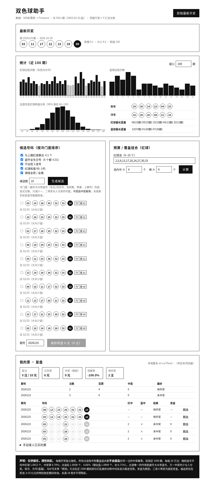

# 双色球助手（fucai-ssq）项目文档

> 状态：本地开发版，已在 Firebase 本地模拟器上跑通。未部署、未推送 GitHub。

## 1. 目标
- 自动获取中国福利彩票**双色球**全部历史与最新开奖（6 红 1–33 + 1 蓝 1–16，每周二、四、日 21:15 开奖）。
- 提供统计（冷热号、遗漏、奇偶、大小、和值）、按偏好过滤的号码生成、按预算的**覆盖组合**（数学上可验证的保证）。
- 同一套算法同时给网页、命令行（CLI）和 MCP（给 AI 助手调用）使用。
- **诚实**：页面明确说明这些功能不提高中奖概率（见第 5 节）。

## 2. 架构
```
500.com 历史页 ──(云函数 fetchLatest / 定时函数)──> Firestore (ssq_draws, meta/ssq)
                                                     │
                     网页 (Vite+React) <──────────────┘   读数据，按钮调用 fetchLatest
packages/core  ← 网页 / functions / cli / mcp 共用
```
| 目录 | 内容 |
|---|---|
| `packages/core` | TypeScript 算法包：解析 500.com HTML、统计、过滤、随机生成、覆盖组合（贪心 + 穷举验证）、奖级判断、回测。带 vitest 测试。 |
| `functions` | Firebase Cloud Functions（2nd gen）：`fetchLatest`（HTTP，带 CORS，网页按钮调用）；`scheduledFetch`（周日/二/四 21:45 北京时间）和 `scheduledFetchRetry`（22:30）。增量：从 `meta/ssq.latestIssue` 的下一期开始抓。 |
| `web` | Vite + React，黑白极简中文界面：最新开奖、「抓取最新开奖」按钮、统计图表、号码生成器（过滤开关）、预算/覆盖组合、免责声明。 |
| `packages/cli` | `fucai latest / stats / gen / cover` |
| `packages/mcp` | MCP 服务器（stdio），工具：`get_latest_draw`、`get_stats`、`generate_tickets`（给 `pool` 时做覆盖组合）。 |
| `scripts/seed.mjs` | 把全部历史灌入 Firestore（默认本地模拟器）。 |

Firestore 结构：`ssq_draws/{issue}` = `{issue:"2026124", date:"2026-10-29", red:[3,11,17,22,23,29], blue:9}`；`meta/ssq` = `{latestIssue, updatedAt, source}`。规则：所有人可读，只有云函数（Admin SDK）可写。

## 3. 数据源
| 来源 | 结果（2026-10-29 从海外服务器实测） |
|---|---|
| **500彩票网** `datachart.500.com/ssq/history/newinc/history.php?start=03001&end=99999` | **主数据源**。HTTP 200，一次返回全部 3521 期（2003001–2026124），约 2 秒；`start=26125` 这类参数可增量取。无 CORS 头，浏览器不能直连，必须经云函数。属于非官方网页抓取，页面结构可能变。 |
| 中国福彩网 cwl.gov.cn `findDrawNotice` 接口 | 官方数据，但从海外 IP 访问被网宿 WAF 拦截（HTTP 403）。国内 IP 是否可用**未验证**。Firebase 云函数都在海外，所以基本用不上。 |
| 中彩网 zhcw.com、17500.cn | 海外访问超时。 |

## 4. Firebase 方案要点（来自官方文档）
- Cloud Functions（包括定时函数，以及访问外网）**需要 Blaze 按量付费套餐**（要绑卡）。免费额度：每月 200 万次调用、40 万 GB·秒、5 GB 出站流量。本项目每周只调用几次，正常不会产生费用，但必须开通 Blaze。
- Firestore 免费额度：存储 1 GiB；每天读 5 万、写 2 万、删 2 万。注意：网页每打开一次会读取全部 3521 条（算 3521 次读），**每天约 14 次打开就会用完免费读额度**。上线前要改成把统计结果预先算好、存成一个汇总文档（路线图第 2 项）。
- 官方 CLI `firebase-tools` 自带官方 MCP 服务器（`npx -y firebase-tools@latest mcp`，官方博客称为实验性）。
- Firebase 的域名和 Google 登录在中国大陆访问不稳定。

## 5. 声明：过滤不提高中奖概率
每期开奖独立随机。对最近 1000 期做回测，每组 20 万注：

| | 平均命中红球 | 中奖率（任一奖级） |
|---|---|---|
| 理论值 | 1.0909 | 约 6.71% |
| 纯随机 | 1.0912 | 6.70% |
| 过滤后 | 1.0938 | 6.66% |

差异只是随机波动。过滤唯一的实际作用是避开大众常选号（如生日号），**万一中奖时少与人分奖**。覆盖组合给的是条件性的保证（例：10 个红球的池，23 注，只要开奖红球有 ≥4 个落在池里，至少一注中 ≥4 个红球），不改变每注的概率。仅供娱乐，理性购彩，未满 18 周岁不得购彩。

## 6. 本地运行
前提：Node 20+、Java 11+（Firestore 模拟器需要；本机装在 `~/jdk`）、`npm i -g firebase-tools`。
```bash
cd /workspace/fucai-ssq
npm install
npm run build && npm test          # 构建并运行 core 测试
./scripts/start-local.sh           # 启动模拟器、灌数据、启动网页
```
- 网页 http://localhost:5173 · 模拟器 UI http://localhost:4000 · Firestore 8080 · Functions 5001
- 按钮接口：`curl -X POST http://127.0.0.1:5001/demo-fucai-ssq/asia-east1/fetchLatest`
- 测试增量：`node scripts/seed.mjs 2`（故意少写最后 2 期）后点按钮。
- CLI：`node packages/cli/dist/index.js latest|stats|gen --n 5|cover --pool 2,5,9,13,17,20,24,27,30,33 --m 4 --g 4`
- MCP：在客户端配置 `{"command":"node","args":["/workspace/fucai-ssq/packages/mcp/dist/index.js"]}`；冒烟测试 `node scripts/mcp-smoke.mjs`
- 说明：本地模拟器不会运行定时函数（需要 Pub/Sub 模拟器），定时逻辑与按钮共用 `syncLatest()`，已通过按钮验证。

## 7. 路线图
1. ✅ 本地版：core + 云函数 + 网页 + CLI + MCP，在模拟器上跑通。
2. 把统计结果预先算好存成汇总文档，网页只读一个文档，以节省 Firestore 读额度。
3. 部署：开通 Blaze → `firebase deploy`；或换成国内平台。
4. 增加备用数据源和告警（500.com 页面结构变化时通知）。
5. 加入快乐8、福彩3D（快乐8 历史已在 PoC 中部分抓取）。
6. CLI/MCP 改为读取 Firestore 或部署后的 HTTP 接口，而不是直接抓 500.com。

---

## 第二版（2026-10-29）：候选排序、我的票、复盘、汇总文档



### 数据结构（Firestore）
| 路径 | 内容 | 谁写 |
|---|---|---|
| `ssq_draws/{issue}` | 每期开奖 + 奖池、一二等奖注数/单注奖金、销量（500.com 提供，开奖当晚可能为 0） | 云函数 |
| `meta/ssq` | 最新期号 | 云函数 |
| `meta/ssq_summary` | **增量汇总**：总期数、全量红/蓝出现次数、最近出现位置（算遗漏）、和值分桶、最近 200 期（约 126 KB） | 云函数 |
| `users/{本地匿名id}/tickets/{id}` | 我的票：红、蓝、目标期号、2 元、冷门度、来源；`result` 复盘结果 | 浏览器建/删；`result` 只由云函数写 |

- 网页加载只读 `meta/ssq_summary` 1 个文档 + 自己的票，不再读 3521 个文档（原先每次加载约 3521 次读取，免费额度一天约 14 次加载）。
- `fetchLatest` 从最新一期（含）开始增量请求，这样当晚奖金未公布时，下次抓取会补上；然后更新汇总，并对目标期号已开奖的票自动复盘。
- 新增 `reviewTickets?uid=` 端点：给已开奖期补录票后手动复盘。
- `firestore.indexes.json`：`tickets.targetIssue` 的集合组索引（正式部署需要）。

### 核心库新增（`packages/core`）
- `checkTicket` / `prizeTierFull`：按 2026 年 1 月财政部批准的现行规则判奖。三等 3000、四等 200、五等 10、六等 5 元；一二等奖用 500.com 公布的单注金额；**福运奖**（中 3 红得 5 元）只在特别规定期间有效：已知 2026014–2026075 期，之后按「奖池 ≥15 亿开始、<3 亿停止」推算（已用 500.com 奖池数据核对：2026075 期后奖池 2.83 亿，与公告一致）。
- `summarizeTickets`：累计花费、中奖、回报率、按期汇总。
- `unpopularityScore` / `generateCandidates`：冷门度排序（见下）。
- `applyDraws` / `statsFromSummary`：增量汇总，测试保证「分批增量 = 一次性全量」，且与 `computeStats` 结果一致。
- `backtestStrategies`：热号/冷号/马尔可夫 vs 随机回测。
- CLI 新增 `fucai cand`、`fucai check --ticket 1,2,3,4,5,6+7 --issue 2026124`；MCP 新增 `check_ticket`、`rank_candidates`。

### 冷门度是什么、不是什么
- 依据：彩民偏爱 1–31（生日）、1–12（月份）、吉利数字、等差/规律图案、上期号码（荷兰、英国研究，见下）。分数越高越「冷门」。
- 作用：一、二等奖按注均分，选冷门号万一中了少和人分。三到六等奖是固定奖金，**不受影响**。**中奖概率完全不变**。
- 局限：没有中国彩民真实选号数据，权重是拍的；分数偏好含 32、33 的组合，候选会比较像。

### 算法调研结论
| 方法 | 结论 | 来源 |
|---|---|---|
| LSTM / 神经网络预测 | 无效；号称高准确率的多为数据泄漏或按「部分命中」夸大 | CSDN 双色球 LSTM 实验 https://blog.csdn.net/NVKD2020/article/details/115002304 ；ICCSA 2026 罗马尼亚 6/49 https://dl.acm.org/doi/10.1007/978-3-032-30518-3_23 ；https://lottochaos.com/en/loto/ai-prediction/ |
| 频率 / 冷热号 / 遗漏 / 马尔可夫 | 无效（见本项目回测） | 同上 |
| 避开热门组合 | **唯一能提高期望值的办法**（少分奖），不提高中奖概率 | BBC/南安普顿大学 http://news.bbc.co.uk/2/hi/science/nature/240734.stm ；EUI 论文 http://hdl.handle.net/1814/610 ；彩民偏好研究 https://www.sas.upenn.edu/~baron/journal/15/151103a/jdm151103a.html |
| 旋转矩阵 / 覆盖设计 | 只是「条件保证」：所选号码池里中了 m 个时，至少一注中 g 个；不提高期望 | La Jolla Covering Repository https://ljcr.dmgordon.org/cover.html （2026-03 冻结，后继 https://www.coveringrepository.com/ ） |

**本项目回测**（近 1500 期，每期每种方法 1 注，随机 30 注/期；理论中≥3 红概率 5.77%）：

| 方法 | 平均中红 | 中≥3 红 |
|---|---|---|
| 随机 | 1.091 | 5.66% |
| 热号（近 50 期最多） | 1.101 | 5.80% |
| 冷号（遗漏最长） | 1.098 | 6.13% |
| 一阶马尔可夫 | 1.121 | 7.87% |

马尔可夫在这一段看着偏高，所以又做了两项检查：① 换两段更早的历史，分别是 6.60%、6.72%（样本 1500、521 期），优势缩小；② 把开奖顺序打乱 40 次（打乱后任何时间规律都不存在）再跑同样方法，中≥3 红比例在 4.67%–7.73% 之间波动，实际值的单侧 p≈0.025。考虑到同时比较了 3 种方法 × 3 个时间段，这**不构成可靠的预测证据**；即使是真的，多出的大多是 5 元小奖，期望回报仍远低于 2 元成本。

### 验证记录（2026-10-29，本地模拟器）
- 灌入 3519 期（故意少 2 期）→ 网页生成候选、勾选 3 注存到 2026123；手动录 3 注到 2026124 → 点「抓取最新开奖」：「已新增 2 期：2026123、2026124，复盘 6 注」。复盘结果：6 红+蓝 → 一等奖 6,656,899 元（500.com 公布的单注金额）、5 红+蓝 → 三等奖 3000 元、3 红 0 蓝 → 未中奖（该期不在福运奖期间）。截图前已删除这 3 注人造测试票。
- 规则：客户端改票 → 403；客户端写开奖数据 → 403。
- 再次抓取幂等（新增 0）。核心测试 17 个全过；CLI `check`、MCP `check_ticket` 均已实测。

### 已知限制
- 本地匿名 id 存在 localStorage：换浏览器或清缓存就看不到之前的票；没有登录，知道 id 的人能读写。上线前应改用 Firebase 匿名登录并在规则里校验 `request.auth.uid`。
- 期号跨年按下次开奖日期推算；春节休市等不计，期号可在页面手动改。
- 奖金税前；单注超 1 万元需缴 20% 个人所得税。奖金和开奖数据来自 500.com，未与中国福彩网逐期核对（福彩网对境外 IP 返回 403）。
- 汇总文档只保留最近 200 期，统计窗口最大 200 期（遗漏、和值分布仍用全量）。

## 第三版：邮箱密码账户（限 10 人）

**设计**
- 前端用 Firebase Auth 的邮箱+密码，提供注册、登录、退出、忘记密码（中文界面）。本地连 Auth 模拟器（9099）。
- 数据都放在 `users/{uid}/tickets`。规则规定只有 `request.auth.uid == uid` 才能读写；票只能新建（字段白名单、cost==2）和删除，不能修改，所以 `result` 只能由服务端（Admin SDK）写。`ssq_draws`、`meta` 只读，`admin/**` 全部禁止访问。
- 限额由服务端保证。阻塞函数 `beforeUserCreated` 在事务里维护 `admin/registrations.uids`：满 10 人时抛 resource-exhausted，返回“注册名额已满（最多 10 人），请联系管理员。”前端从 `auth/internal-error` 的报错里识别出这句中文并显示。删除用户时，`releaseSeat`（v1 auth onDelete）会释放名额，并删除该用户的 `users/{uid}`。
- 备用方案：可调用函数 `registerUser`（`VITE_REGISTER_MODE=callable`）。它先检查邮箱是否重复，然后占名额，再用 Admin `createUser` 建账号；建号失败会归还名额。用这个方案时，要在控制台关闭客户端自助注册，否则别人可以绕过它。
- 复盘：可调用函数 `reviewMyTickets` 从 `req.auth` 取 uid，未登录时拒绝。定时同步时的 `reviewIssues` 用 collectionGroup 查询所有用户的票（索引见 `firestore.indexes.json`）。

**验证（都在模拟器里实际运行过）**
- `npm run test:rules`：10 条规则单测通过。
- `npm run test:auth`：17 项全部通过。包括：
  - 前 10 个注册成功，第 11 个被拒；
  - 满员时并发 3 个注册全部被拒；
  - 删除用户后名额释放，可以再注册；
  - B 读不到 A 的票，也写不进 A 名下；
  - 客户端不能改 `result`；
  - 未登录不能复盘；
  - 复盘写入二等奖 75313；
  - callable 方案同样限制 10 人，并能拒绝重复邮箱。
- 浏览器（Playwright）：注册/登录 demo@example.com，录入第 2026124 期的 2 注票。服务端写回了二等奖 75313 和六等奖 5（已在 Firestore 中直接核对）。截图见 docs/screenshot3.png（左边是登录页，右边是登录后的页面）。

**限制**
- 名额名单和 Auth 靠 onDelete 触发器同步，如果漏掉触发，名单会多占名额，需要管理员手动修正 `admin/registrations`。
- 模拟器不会真的发重置邮件，链接在模拟器 UI 的 Auth 页面或日志里。`npm run test:auth` 会清空模拟器里的用户和 `users/`。
- 阻塞函数返回的错误码是 internal-error，前端靠文字匹配识别，不够优雅。

**真正部署还需要**
1. 升级到 Blaze 计费方案，并启用 Identity Platform（阻塞函数依赖它）；如果不想启用，就改用 `registerUser` 方案，并关闭客户端注册。
2. 在 Authentication 中启用 Email/Password 登录方式，把站点域名加入授权域名，并配置发信模板或自定义发件域名，用于找回密码。
3. 运行 `firebase deploy --only functions,firestore:rules,firestore:indexes,hosting`，并把前端里的 `VITE_` 配置改成真实项目的配置。
（本次没有推送代码，也没有部署。）

## 第四版：手机端彩票风格界面
- 手机优先（宽度 375–480px）。整体是红金配色，红球、蓝球带高光。底部有 4 个标签页：首页（上期开奖、热号、好久没出、最近几期）、选号、我的号码（登录、对奖）、走势。
- 一键选号：按注数或按金额（2 元一注，最多 50 注），点一下「帮我选」就出号。先用默认过滤条件多生成一批，再按冷门度从高到低挑；同一批里任意两注红球最多重 2 个，每个红球出现的注数不超过总注数的 40%。可以全部保存、只存勾选的、换一批、复制号码。条件选号和旋转矩阵放在「高级选号」里。
- 截图（390×844）：docs/mobile-home.png、mobile-pick.png、mobile-advanced.png、mobile-login.png、mobile-mine.png、mobile-review.png、mobile-trend.png。
- 冷门度评分偏好 32、33 这类大号（超出生日范围），所以一键选号的结果里大号会比较多，这是评分方式决定的，不代表这些号更容易中。

## 第五版：免费 Spark 方案（不用云函数）

- **后端 = GitHub Actions**：`.github/workflows/sync.yml` 在北京时间周二/四/日 21:45、22:30 运行（UTC cron `45 13 * * 0,2,4`、`30 14 * * 0,2,4`；GitHub 定时可能延迟几分钟到几十分钟），也可手动 `workflow_dispatch`。运行 `scripts/sync.mjs`（firebase-admin + 服务账号）：
  1. 从 500.com 增量抓取（从已存最新一期开始），写 `ssq_draws`、`meta/ssq`（含 `checkedAt`）、`meta/ssq_summary`；
  2. 服务端复盘：对本次抓到的期和最近 30 期的票写 `result`（结果没变就不写）；
  3. 10 人上限：列出全部 Auth 用户，已在名单 `admin/registrations` 的优先，其余按创建时间；第 11 个起**禁用**（手动运行勾选 `delete_extra` 则**删除账号和数据**）。
- **取舍（名额）**：没有阻塞函数，Auth 端注册是开放的。超额账号在下一次同步前（最长约 2–3 天，或手动运行一次）可以登录和存票，只能看到自己的数据；被禁用后无法登录。名额空出后，被禁用的账号不会自动恢复，需要在控制台手动启用。想立即生效就在 Actions 页手动运行一次。
- **前端**：打开时比较库里最新一期日期和「应已开奖日期」（周二/四/日 21:15 后算当天）。过期则弹「数据正在更新」（显示上次更新时间、「再看一下」只重新读 Firestore、「先用旧数据进入」）；最新则提示「已是最新」1 秒后消失。页面不触发 Actions（需要令牌，不放在前端）。截图：`docs/mobile-sync-popup.png`、`docs/mobile-sync-fresh.png`。
- **复盘显示**：有开奖数据就在页面本地计算；服务端写的 `result` 作为持久记录（超出最近 200 期时用它）。
- `functions/` 保留为可选（Blaze 付费方案），已从 `firebase.json` 和 `npm run build` 移除；旧的函数端测试移到 `functions/auth-e2e.blaze.mjs`。
- 测试：`npm test`（core 19）、`npm run test:rules`（10）、`npm run test:sync`（13，需模拟器：增量补 3 期、服务端复盘二等奖、第 11/12 个被禁用且登录报 `auth/user-disabled`、重跑幂等、`--delete-extra`、用户隔离）。
- Spark 配额（免费）：Firestore 每天 5 万读 / 2 万写 / 2 万删，1 GiB 存储；Hosting 10 GB 存储、每天 360 MB 流量（以官方页面为准：https://firebase.google.com/pricing）。首次全量约 3500 次写，之后每次同步几十次。

### 部署清单（由你操作；本地尚未推送或部署）
1. https://console.firebase.google.com 新建项目（保持 Spark 免费套餐，不绑卡）。
2. Build → Authentication → 开始 → 登录方式启用「电子邮件/密码」。
3. Build → Firestore Database → 创建数据库（生产模式，区域建议 `asia-east1` 或 `asia-east2`，创建后不能改）。
4. 项目设置 → 你的应用 → 添加「网页应用」→ 把配置填进 `web/.env.production`（参考 `web/.env.production.example`）。
5. 项目设置 → 服务账号 → 生成新的私钥（JSON）。**不要提交到仓库**（已在 `.gitignore`）。
6. 新建 GitHub 仓库 → Settings → Secrets and variables → Actions → 新建 `FIREBASE_SERVICE_ACCOUNT`，值为整个 JSON 内容。公开仓库 Actions 免费；私有仓库每月有免费分钟数（本任务每次约 1–2 分钟）。
7. `git init && git add . && git commit -m init && git remote add origin … && git push -u origin main`。
8. 首次灌数据：Actions 页 → sync-ssq → Run workflow（首次会全量抓取，约 3500 期）。
9. 部署网页和规则：`npm i -g firebase-tools && firebase login && firebase use <项目ID>`，然后 `npm run build -w @fucai/core && (cd web && npx vite build) && firebase deploy --only hosting,firestore:rules,firestore:indexes`。
10. 打开 `https://<项目ID>.web.app` 注册自己的账号（越早注册越靠前）。
11. 可选：名额满后要彻底关掉新注册，可在 Authentication → 设置 → 用户操作 关闭「允许注册」（此开关可能需要升级 Identity Platform，未验证）。

提醒：国内直连时 Firebase 登录和数据库接口经常受干扰（见上一轮调研），页面能打开不代表能稳定登录。
